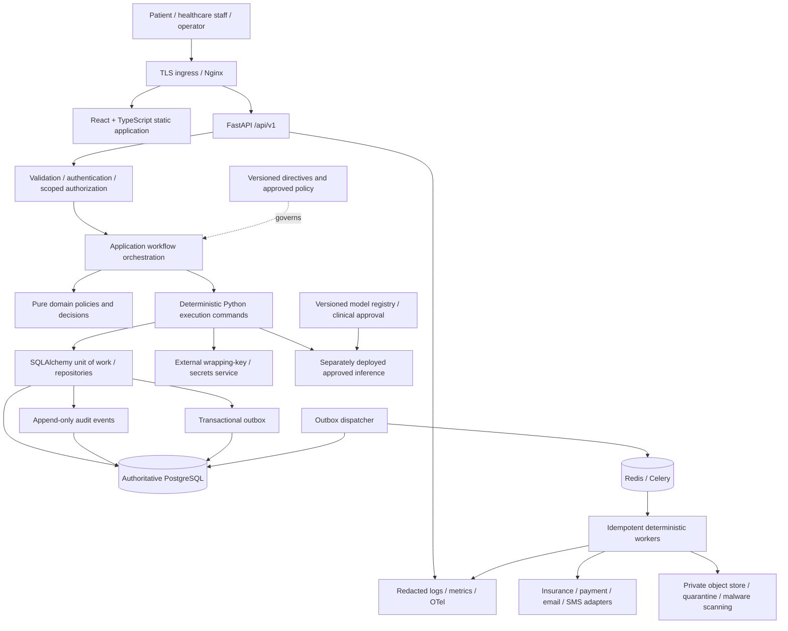
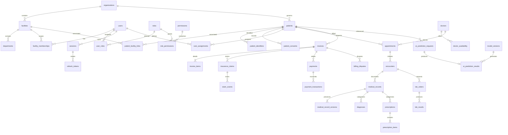

# HCS architecture proposal

**Status: proposed, not implemented or deployed.** 2026-09-22.

## 1. System boundaries

The mandatory presentation → API/application → domain services → governed orchestration → deterministic execution → database/external-services sequence describes responsibility boundaries. Pure domain services validate and produce decisions; the orchestrator selects and sequences execution commands. An implementation must not turn these responsibilities into a cyclic call graph or let the orchestrator obtain a database session.

### Module rules

- **Directives:** version-controlled SOPs specify inputs, rules, authorization, outputs, failures and acceptance tests. Missing original SOPs must be resolved explicitly; proposals cannot masquerade as preserved originals.
- **API/application:** parse transport contracts, acquire trusted authentication context, invoke workflows, and render typed envelopes. No SQL or provider HTTP calls.
- **Domain services:** typed, deterministic validation/state-transition rules. No database or network dependencies. Business rules belong here, not in React.
- **Governed orchestration:** takes trusted principal and validated command; evaluates policy and chooses deterministic commands. No session, SQL, or raw DB writes. AI cannot authorize operations or generate execution SQL.
- **Execution:** owns transaction boundaries, repository calls, audit/outbox/idempotency persistence and provider interactions through restricted adapters. Revalidates security/integrity preconditions under locks as required.
- **Repositories:** tenant-scoped SQLAlchemy 2.x queries and persistence only. They do not choose workflow policy or commit independently.
- **Workers:** Celery executes deterministic commands with an explicit organization, initiating actor/system identity, correlation ID and idempotency context. Authorization-sensitive exports recheck current permissions before release.

Proposed layout adds `backend/app/orchestration/` and `backend/app/execution/` to the requested tree to make its core principle explicit. Patient/scheduling/clinical/billing feature modules own their policy; central `services/` contains shared services only. Avoid two parallel implementations of the same domain.

## 2. Authoritative storage and transaction model

PostgreSQL is the sole healthcare/system-of-record database. Redis is an expendable broker/cache/rate-limit store, never the source of truth for appointments, financial balances, sessions or audit.

One execution command opens a unit of work. It checks authorization, validates state under necessary locks, applies domain updates, writes audit and outbox events, and stores idempotency outcome before committing. External network calls do not run inside long-held healthcare transactions. Multi-step external workflows use explicit pending/retry/confirmed/reconciled states.

### Conceptual ERD — not a completed physical schema

All tables required in §6 remain in scope, including those omitted from this conceptual diagram: wards, rooms, nurses, administrators, staff profiles/specializations, patient contacts/emergency contacts/policies, appointment history/reminders/slots, visit notes/documents, security/access/data-access logs, notification templates/attempts and model audit events.

Additional proposed tables: facility memberships, role permissions, patient facility links, care assignments, encounters, transactional outbox, idempotency requests, emergency grants, legal holds, retention policies, import/export jobs and non-secret settings. These are explicit design proposals, not preexisting requirements.

Patient identity ownership, cross-facility sharing, staff identity linkage and encounter cardinality need approval before the physical model is frozen. Scope columns alone are insufficient: cross-table organization consistency must be protected by composite constraints and authorization, not merely convenient ORM filters.

### Integrity controls

- UUID keys, aware timestamps, actor metadata, strict FKs, bounded enums/check constraints and indexes aligned to tenant-scoped queries.
- PostgreSQL `tstzrange` exclusion for clinician time occupancy, normally using `btree_gist`. Privileged migration credentials install extensions; runtime credentials cannot.
- Compare-and-swap version checks for clinical amendments; prior ciphertext remains immutable.
- Exact-decimal monetary amounts, explicit currency, immutable provider transaction identifiers and aggregate locks during settlement.
- Database-backed scoped idempotency binds operation/key to request digest and a replayable result. Reauthorization precedes replay. Retention of dedupe evidence must outlast provider replay/reconciliation windows.
- No routine hard deletion of clinical versions or audit rows. Retention and holds are policy inputs awaiting approval.

## 3. Authentication architecture

Selected: application-managed identity using Argon2id password hashing, short-lived signed JWT access tokens and opaque rotating refresh tokens stored only as digests. Use a vetted JWT library, explicit algorithm allowlist, issuer/audience/time validation, key identifiers and an external private-key source.

Proposed browser design: access token in memory; refresh token in Secure/HttpOnly/SameSite cookie restricted to the refresh route; explicit trusted-Origin and CSRF checks for cookie-authenticated operations. No localStorage access or refresh tokens. No sensitive credentials in URLs. Non-browser clients require a separately documented credential flow.

Session and account status must be checked for immediate revocation guarantees; simply waiting for JWT expiry does not satisfy immediate disable/logout. Availability and acceptable revocation delay must be agreed. Refresh rotation is atomic, with reuse detection and family revocation. Concurrent browser refresh is coordinated in the client; server-side replay behavior must be documented and tested.

JWT use does **not** make the service an OIDC provider. Decide whether “OIDC-compatible” means a future provider-adapter boundary or full authorization-code/PKCE provider functionality. Do not build or claim a bespoke compliant identity provider by accident.

Staff accounts are provisioned through controlled administration; public registration cannot select a staff role. Linking a registered user to a patient needs a verified identity workflow, not matching a name or email. MFA is required for privileged deployment in this proposed security policy, subject to organizational approval; general optional MFA remains in scope.

## 4. Authorization proposal

A request is allowed only when the role permission **and** organization/facility membership **and** resource relationship **and** lawful-purpose/consent policy allow it. Deny by default. Super administrator is not a clinical-data superuser.

| Role | Proposed permitted scope | Explicit exclusions |
|---|---|---|
| PATIENT | Verified own patient profile, permitted records, appointments, bills, consent, notifications | Other patients; internal security and clinician-only restricted content |
| DOCTOR | Active assigned/authorized care relationship, relevant clinical data, authorized clinical authorship | Unrelated patients; financial operations; unrestricted facility traversal |
| NURSE | Assigned care workflows and permitted observations | Unapproved prescribing/diagnosis powers or unrelated records |
| BILLING_STAFF | Authorized billing identity fields, invoice/claim/payment/dispute workflows | General clinical notes and unrelated clinical content |
| LAB_TECHNICIAN | Assigned orders, required identity fields and authorized lab-result workflow | General clinical edits, billing and unrelated patients |
| ADMIN | Scoped users/facilities/departments/operational configuration | Automatic clinical access, secrets, unilateral elevation beyond delegated powers |
| SYSTEM_AUDITOR | Scoped append-only audit/security evidence | Clinical record mutation; unnecessary medical payload disclosure |
| SUPER_ADMIN | Explicit infrastructure/system administration | Implicit unrestricted clinical access or audit deletion |

The role names come from the specification. Exact actions, care assignments, consent/legal bases, record restrictions and emergency grants require an approved permission matrix. Break-glass is a separately authorized, patient-specific, time-limited, reason-bearing grant with alert/review; it cannot bypass integrity rules or payment permissions.

## 5. Security architecture

Threats include stolen sessions, insider browsing, cross-tenant IDOR, export exfiltration, malicious uploads, provider replay, supply-chain compromise, database administrator tampering and ransomware.

- TLS ingress, HSTS after verified TLS deployment, CSP/secure headers and a narrow CORS allowlist.
- Database application role lacks DDL/audit mutation powers; separate migration, backup and auditor identities.
- AES-256-GCM envelope encryption for sensitive clinical content. Bind tenant/resource/version in authenticated context. Use unique nonces and externally wrapped per-object data keys. Keys and plaintext never enter logs.
- Key rotation retains old wrapping-key versions for authorized historical reads and restores. Rewrapping keys is distinct from content-key rotation, which creates a new encrypted version under controlled audit.
- Clinical read authorization and durable access audit occur before plaintext release; audit failure denies release.
- Structured logs and tracing redact medical fields, tokens, passwords and query payloads. Metrics never use patient/user IDs as labels.
- Uploads enter private quarantine, receive size/signature/MIME checks and malware scanning, then approved objects become downloadable through authorized audited access. A scanner outage must not publish unscanned content.
- External adapters use fixed approved destinations, TLS verification, timeouts and bounded retries; no user-provided target URLs or implicit cross-host credential forwarding.
- Runtime secrets use an external secret-management mechanism. Sample configuration must contain descriptions/placeholders only.

This is a design, not evidence these controls exist.

## 6. AI architecture and clinical safety

Training/evaluation are offline and separate from API deployment. Registry entries pin dataset lineage, feature schema, artifact digest, evaluation metrics, limitations, intended and prohibited use, clinical approval and deployment state. Inference runs as an independently versioned internal service without arbitrary database access. The API's deterministic execution records request/result/version/audit in authoritative storage.

No model or clinical validation has been supplied. Inference remains unavailable until an approved artifact and safety rules exist. Synthetic-data research can be isolated and clearly labeled, but its scores are not clinical accuracy. UI must never substitute fabricated confidence or top-three diagnoses for an unavailable model. Emergency advice must be approved for the deployment jurisdiction; symptom rules are not a complete triage system.

## 7. Deployment and observability

Proposed portable containers: API, Celery workers, outbox dispatcher, scheduler, static frontend/Nginx; managed or separately operated PostgreSQL/Redis; private object store and external secrets/KMS. Local Compose also uses Vite. Production never uses a Vite dev server or debug backend.

Staging target is **unknown**, despite being reported available. Do not select Kubernetes, a cloud, region, ingress, object store or identity endpoints silently. Real deployment procedures depend on those decisions.

API and workers are horizontally scalable. Use one effective scheduler leader or database-backed task uniqueness. Use expand/contract migrations and health-gated rollout. Queue messages refer to persisted work rather than embedding unnecessary PHI. Replay from outbox recovers lost broker work.

Telemetry: JSON logs, Prometheus-compatible metrics, OTel traces, dependency checks and alerts for downtime, p95 latency, error rate, DB/Redis availability, worker heartbeat, queue age/depth, delivery failures, provider failures and authentication anomalies. `/health/live` reports process liveness; `/health/ready` verifies required dependencies within strict timeouts; public responses must not expose infrastructure secrets. Detailed operational dashboards and metrics require restricted access.

Backup design: encrypted base backups/WAL for PostgreSQL PITR, object versioning/backups, separated immutable backup credentials, key recovery and regular isolated restores. RPO/RTO, retention, region strategy and backup frequency await approval. No recovery guarantee is made without measured drills.

## 8. Decision status

Accepted from user: greenfield baseline; mandated FastAPI/PostgreSQL/React stack; HCS-managed authentication; staging-first validation.

Proposed here: explicit orchestration/execution packages, modular monolith with independently deployable workers/inference, transactional outbox, scoped relationship-based authorization, envelope encryption and dependency boundaries.

Open: jurisdiction/organization model; OIDC scope; staging infrastructure; provider contracts; clinical payloads; patient identity matching; emergency policy; terminology licensing; retention/consent; recovery targets; clinically approved model and safety rules.
