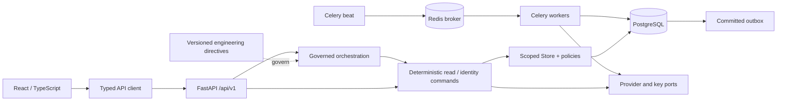

# Implemented architecture and change decisions

Date: 2026-09-22. Scope: synthetic engineering foundation, not the complete target architecture. The original architecture proposal remains a target/design record.

API handlers validate schemas and delegate. Orchestration has no database session or SQL imports; boundary tests enforce that constraint. Execution owns authorization, transaction, audit, outbox and idempotency behavior. Health SQL is in a deterministic probe, not an HTTP handler. The frontend never decides availability, monetary totals, privileges or provider settlement.

## Data boundaries

User → facility membership → facility → organization. Patients belong to a facility; clinicians need explicit assignments for clinical scope. Patient self-access requires a stored user link, not email/name matching. An infrastructure role does not bypass clinical authorization. This is a conservative implementation, not approval of a multi-country tenant-sharing policy. Patient transfers, cross-facility care agreements and emergency grants are not implemented.

PostgreSQL is authoritative. The exclusion constraint uses the clinician identity across facilities, active status and half-open timestamp ranges. Advisory/row locks coordinate conflicting commands; independent unique constraints enforce invoice source uniqueness and idempotency scope. Redis loss cannot erase committed domain/outbox writes; request limiting fails closed when Redis is unavailable.

## Identity and privacy

Current JWT signing uses application-owned HS256 with issuer, audience, expiry and session checks. This is **not** an OIDC authorization server or an asymmetric key lifecycle. Bearer tokens live only in browser memory. Refresh values are opaque, hashed at rest, rotated under lock and sent in HttpOnly/SameSite=Strict cookies; refresh requires an exact allowed Origin. Roles come from current server membership state. Revoked sessions fail continuing access.

Sensitive profile/clinical/prediction payloads use per-object AES-256-GCM data keys and authenticated organization/resource/version context. Only wrapped keys and ciphertext are persisted. The local development wrapper is explicitly forbidden in staging/production. A rewrap primitive is tested, but no production KMS adapter, rotation job or external key disaster recovery is active.

Database immutable-table triggers are independent of HTTP behavior. They do not protect against a database owner who can disable triggers. The supplied runtime-grants template must be reviewed and applied with a separate migration role; the local development database still uses its owner role. External immutable audit retention remains required.

## Explicit engineering decisions / changes

1. **No invented clinical schemas.** Four record discriminators and encrypted version/access primitives exist; authoring/signing/terminology workflows remain unavailable pending approved field-level contracts. Draft model metadata never activates a model.
2. **Invoice drafts only.** Generic internal service references and exact decimal totals can be exercised without pretending CPT validation, tax, currency precision policy, insurer submission or payment settlement exists. `XXX` is used in synthetic fixtures.
3. **Snapshot preservation (0005).** Profile edits previously retained only the current encrypted profile. Immutable encrypted snapshots now preserve subsequent edits, including patient-supplied history. Migration 0005 backfills only each existing patient's current version; it cannot reconstruct earlier overwritten versions. Existing data here is synthetic. Revision 0006 adds a redacted, scoped profile-history retrieval API/UI and preservation holds.
4. **Technical scheduling limits.** Current request bounds, offset-aware timestamps, slot intervals and maximum booking duration are engineering constraints in the schemas, not clinical scheduling policy. Country/timezone-specific appointment SOPs remain unapproved.
5. **Container remediation.** Actual scans found 46 HIGH backend and 58 HIGH/3 CRITICAL frontend findings. Backend moved from Debian slim to Python 3.12 Alpine; frontend moved from old Nginx 1.28 to the current unprivileged stable Alpine base; OS packages were upgraded and pip/setuptools removed from the backend runtime. Both rebuilt production images were rescanned. Python 3.12 Alpine integration tests passed, so the libc change was not assumed compatible without testing.
6. **Image provenance limitation.** Base tags/OS repositories remain mutable during build. Preserve the scanned output image ID/digest and promote that same artifact; registry signing, base-digest pinning/update automation and CI action SHA pinning remain hardening work.
7. **No pretend deployment.** VM/Compose staging was selected, but target details were not supplied. Production reference configuration deliberately has no working KMS and readiness fails. Deployment automation intentionally exits nonzero until release authorization is real.

8. **Account/operations (0006).** One-time challenges, TOTP, scoped operator administration, versioned preferences/configuration, encrypted hold events and encrypted exchange jobs add nine tables. Queued imports use atomic savepoints and worker reauthorization. TTL expiration denies access but retains ciphertext.
9. **Quarantine (0007).** Two tables separate document metadata from encrypted development-only objects, with append-only object protection. Production storage/scanning are unconfigured; test-injected scan verdicts are forbidden outside testing. See the independent-workflow runbook for structural validation limits and unreleased retention/transport work.
